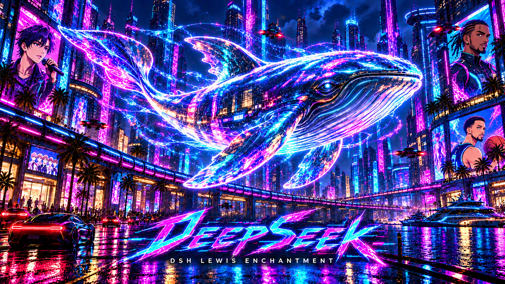
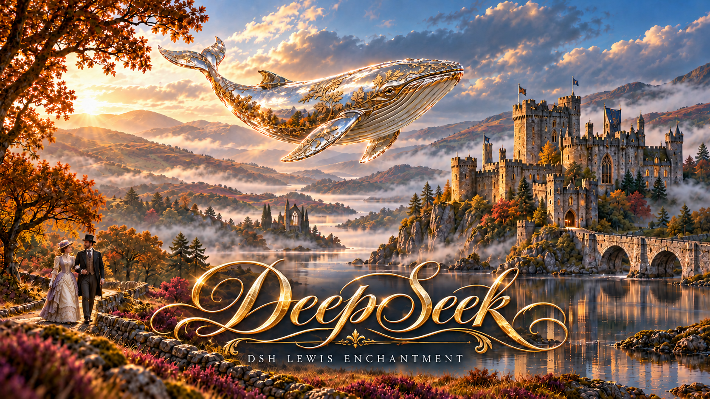
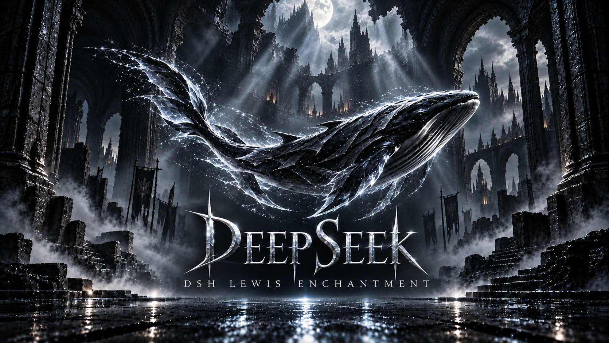
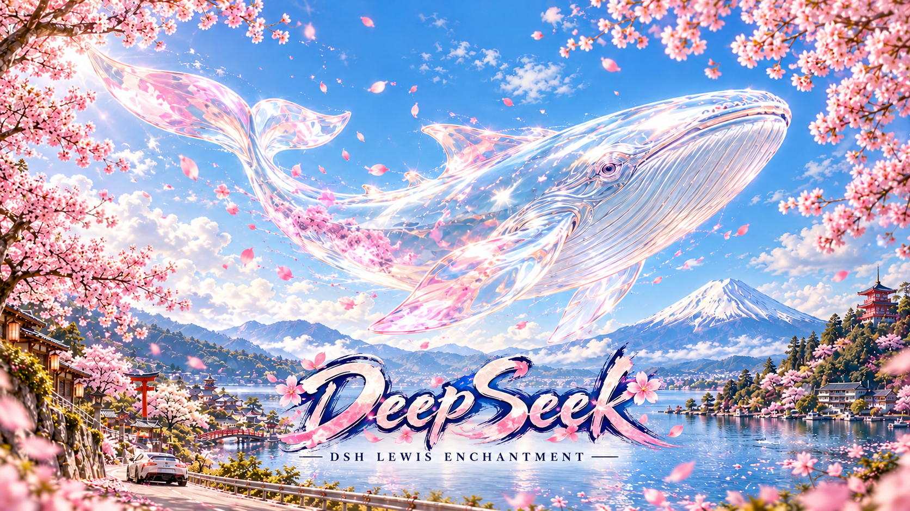

`dsh-openup-lewis`
[English](./README.md) | 简体中文

# DSH LEWIS ENCHANTMENT｜开机动画

## 事先声明

作者才疏学浅，大多借助了AI的帮助，才完成了这一个插件。目前这个插件也没有进入主流插件市场。同时，也是最重要的一点，本插件所用的9条视频，均是从GitHub上其他优秀作者处复制过来的。在readme的最后附上了开源许可。本插件从来没有任何盈利性质，没有任何功能是需要付费后才能使用的。如果构成了侵权，请发邮件至lewiszhouyichen@gmail.com。谢谢

## 产品介绍

自定义你的开场，封面与声音。只需在DeepSeek Harness里面安装插件的地方输入dsh-openup-lewis，即可安装、更新。支持NPM官方源以及国内镜像源。

本插件是由DSH LEWIS ENCHANTMENT创建，主要功能是为 DeepSeek Harness 带来完整开场、DeepSeek 标题封面，以及按任意键进入的游戏式启动体验。让你的DeepSeek Harness不再无聊。

## 产品功能

- **完整开场**：内置「启」「数字生命」「朋克」「半面」「鲸鱼娘」「DeepSeek」「舞」「海」「莱茵生命」九段视频，视频按原长度、原速播放，铺满当前 Harness 窗口。
- **任意键进入**：同时启用两段开场时，动画中按任意键或点击进入结束画面，再操作一次进入 Harness；仅启用视频时，播放结束或跳过后直接进入。
- **九款结束画面**：「远山」「黑金」「蓝雾」「刺客信条」「赛博朋克2077」「GTA6」「地平线5」「地平线6」「地平线4」模拟进入游戏的感觉，为视频播放结束后停留的画面。设置里面支持预览。
- **自定义素材**：支持用户上传自己的视频作为开场、喜欢的图片作为结束封面。
- **独立播放开关**：开机动画与结束停留画面分别启用，可仅视频、仅图片、两者都播放或直接进入应用；另有播放声音与随机开场。
- **适配性**：跟随 Harness 的通用浅深色、字号、字体和强调色，透出当前界面的背景。
- **启动检查更新**：每次重新打开 Harness 自动检查新版本，开场结束并进入应用后再提醒；可选择稍后或直接更新，无需先卸载。
- **可选快捷入口**：默认从设置进入，可自行开启头像上方的“开机动画”按钮；附魔台系列共享最多 17 个快捷入口。
- **本地保存**：个人视频、图片和播放偏好保存在本机，正常更新后保留。
- **恢复默认**：设置底部可一键恢复安装时的状态；二次确认后重置全部偏好并永久删除所有上传的视频和图片，保留内置动画与封面。

## 产品图片展示

- **事先声明**：由于视频过大的原因，此处无法展示相关开机视频，作者对此十分抱歉。大部分视频，都是在抖音上能刷到的热门视频。以下是四张标题封面的展示

**赛博朋克2077**

**地平线4**

**刺客信条**

**地平线6**

## 产品基本信息

| 项目 | 信息 |
| --- | --- |
| 系列名称 | DSH LEWIS ENCHANTMENT · 附魔台|
| 功能项目 | 开机动画 |
| 插件名称 | dsh-openup-lewis |
| 当前版本 | 1.2.10 |
| 作者 | FerrariLewis |
| 适用版本 | DeepSeek Harness ≥ 0.2.1-rc.2 且 < 0.3.0 |
| 桌面平台 | Windows / macOS；已完成跨平台代码检查及 Chromium 播放验证，macOS 尚未进行真机测试|
| 窗口按钮 | 当前 Harness 桌面版尚未提供插件单独隐藏原生关闭、最大化、最小化按钮的接口。因此无法做到完美适配全屏幕|
| 安装方法 | 在 Harness → 插件 → 添加插件 → 包名或地址中，粘贴本文第一行的安装码,即dsh-openup-lewis，安装并启用后重新打开 Harness。无需 Git、npm 账号或命令行|
| 设置入口 | 设置 → 开机动画 |
| 视频格式 | MP4 / M4V / WebM，单个文件最大 200 MB |
| 图片格式 | PNG / JPEG / WebP，单张图片最大 20 MB |
| 更新入口 | 启动时自动检查；也可进入设置 → 开机动画 → 版本与更新，手动检查。npm 分发版从 npm 源获取已公开的版本|
| 开源许可 | [BSD-3-Clause](LICENSE)；素材来源与授权见[第三方说明](THIRD_PARTY_NOTICES.md)。 |
| 鲸鱼娘素材 | 美术及动画画面按 CC BY-NC-SA 4.0 非商业分发，保留完整作者署名；详见[素材说明](assets/deepsea-notices/ADAPTATION.md)。 |
