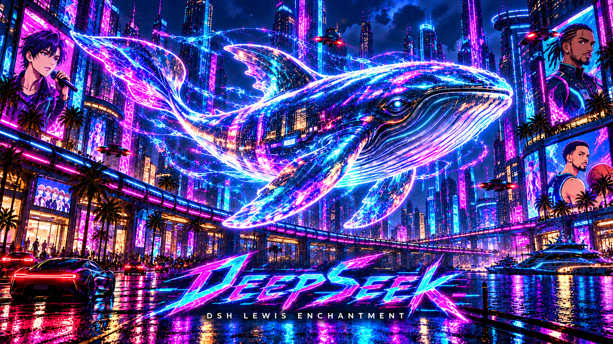
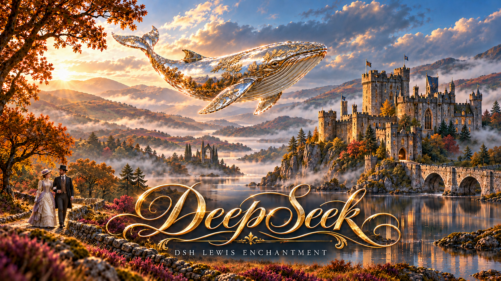
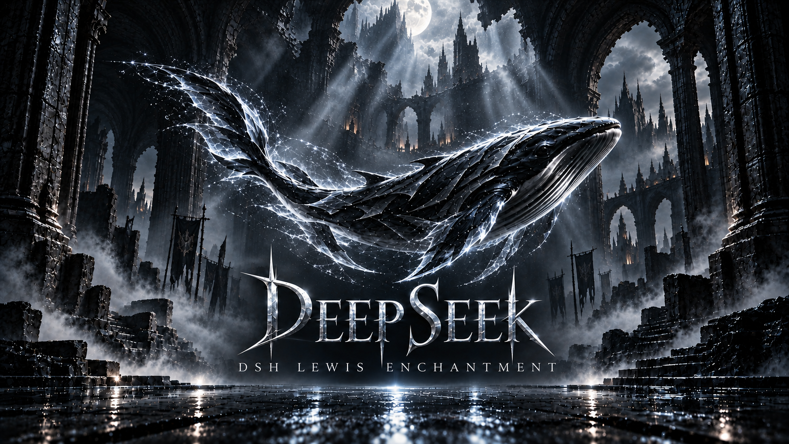
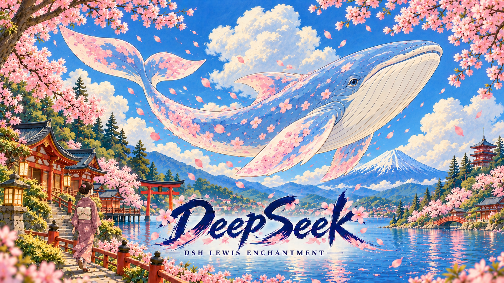

`dsh-openup-lewis`

English | [简体中文](./README.cn.md)

# DSH LEWIS ENCHANTMENT | Startup Animation

## Disclaimer

My skills and knowledge are limited, and I created this plugin largely with the help of AI. It is currently not available in mainstream plugin marketplaces. Most importantly, all nine videos included in this plugin were copied from projects by other talented creators on GitHub. The relevant open-source licenses are provided at the end of this README. This plugin is entirely noncommercial, and none of its features require payment. If any content infringes your rights, please contact me at lewiszhouyichen@gmail.com. Thank you.

## Introduction

Customize your opening sequence, cover images, and sound. Simply enter `dsh-openup-lewis` in the plugin installation section of DeepSeek Harness to install or update it. Both the official npm registry and domestic mirror registries in China are supported.

Created by DSH LEWIS ENCHANTMENT, this plugin brings complete opening sequences, DeepSeek title screens, and a game-style “press any key to enter” experience to DeepSeek Harness. Make your DeepSeek Harness experience less boring.

## Features

- **Complete opening sequences**: Includes nine built-in videos: “Beginning,” “Digital Life,” “Punk,” “Half Face,” “Whale Girl,” “DeepSeek,” “Dance,” “Sea,” and “Rhine Lab.” Videos play at their original length and speed, filling the current Harness window.
- **Press any key to enter**: When both the startup video and title screen are enabled, pressing any key or clicking during playback skips to the title screen; another keypress or click enters Harness. When only the video is enabled, Harness opens directly after playback ends or is skipped.
- **Nine title screens**: Choose from “Distant Mountains,” “Black and Gold,” “Blue Mist,” “Assassin’s Creed,” “Cyberpunk 2077,” “GTA 6,” “Forza Horizon 5,” “Forza Horizon 6,” and “Forza Horizon 4.” These screens remain visible after the video ends, recreating the feeling of launching a game. Previews are available in settings.
- **Custom media**: Upload your own startup videos and use your favorite images as title screens.
- **Independent playback controls**: Enable the startup video and title screen separately. Play only a video, display only an image, use both, or enter the app directly. Sound playback and random startup videos are also available.
- **Appearance integration**: Follows Harness’s light and dark themes, font size, font family, and accent color, while allowing the current interface background to show through.
- **Update checks at startup**: Automatically checks for new versions whenever Harness is reopened. Update notifications appear after the startup sequence finishes and you enter the app. You can update immediately or postpone, with no need to uninstall first.
- **Optional shortcut**: Access the plugin through settings by default, or enable a “Startup Animation” button above your avatar. The Enchantment series supports up to 17 shared shortcut entries.
- **Local storage**: Your videos, images, and playback preferences are stored locally and retained during normal updates.
- **Restore defaults**: Restore the plugin to its initial state using the button at the bottom of settings. After a second confirmation, all preferences are reset and all uploaded videos and images are permanently deleted. Built-in videos and cover images are retained.
- **Optional data sharing in newer versions**: After updating to a version that includes this feature, select “Share data with the developer” beside the author-information entry to read the notice. Sharing is off by default. After explicit consent, the plugin can report the signed-in nickname, an account identifier used for server-side HMAC deduplication, plugin and Harness versions, operating system and language, and activity times. You can stop sharing and request deletion from the same dialog. Login tokens, API keys, contact information, conversations, and balances are not collected. Account identity is client-reported, and no data source is available for membership levels. New repository features may appear before npm approval; actual installation and update availability follows the official npm `latest` version.

## Screenshots

- **Please note**: The startup videos cannot be displayed here because the files are too large. I apologize for the inconvenience. Most are popular videos you may have come across on Douyin. Below are four examples of the title screens.

**Cyberpunk 2077**

**Forza Horizon 4**

**Assassin's Creed**

**Forza Horizon 6**

## Share Data with the Developer

Only the author can access this dashboard by signing in with their own OpenAI / ChatGPT account. The author commits to protecting users’ privacy. Ordinary users do not need an OpenAI account to install, update, or use the plugin through npm. Simply enter `dsh-openup-lewis`, shown above, in the DeepSeek Harness plugin installation page. The plugin and source repository remain publicly available.

To help the author understand plugin usage, select “Share data with the developer” on the last row of plugin settings and read the notice before choosing to enable it. Sharing is off by default, does not affect any plugin features, and can be stopped with a deletion request at any time.

We strive to offer more people a better experience. However, we apologize that, for various reasons, the “Share data with the developer” feature is currently available only in regions supported by OpenAI. For details, see [OpenAI’s official guidance](https://help.openai.com/en/articles/7947663-chatgpt-supported-countries?utm_source=chatgpt.com).

## Plugin Information

| Item | Details |
| --- | --- |
| Series | DSH LEWIS ENCHANTMENT · 附魔台 |
| Feature | Startup Animation |
| Plugin name | dsh-openup-lewis |
| Author | Zhou Yichen (周奕辰) |
| Current npm version | See the [official npm package page](https://www.npmjs.com/package/dsh-openup-lewis); installations and updates follow npm `latest`. |
| Latest version | v1.4.3 |
| Supported version | DeepSeek Harness ≥ 0.2.1-rc.2 and < 0.3.0 |
| Desktop platforms | Windows / macOS. Cross-platform code checks and Chromium playback validation have been completed. Testing on a physical Mac has not yet been performed. |
| Window controls | The current Harness desktop app does not provide an API that allows individual plugins to hide the native close, maximize, and minimize buttons, so a completely seamless full-screen experience is not currently possible. |
| Installation | Go to Harness → Plugins → Add Plugin → Package Name or Address, paste dsh-openup-lewis, then install and enable the plugin. Reopen Harness afterward. No Git, npm account, or command line is required. |
| Settings | Settings → Startup Animation |
| Video formats | MP4 / M4V / WebM; maximum 200 MB per file |
| Image formats | PNG / JPEG / WebP; maximum 20 MB per image |
| Updates | Updates are checked automatically at startup. You can also check manually under Settings → Startup Animation → Version & Updates. The npm-distributed edition retrieves published versions from the npm registry. |
| Dashboard | For the author only: [Open the author dashboard](https://dsopen-console-lewis.lewiszhouyichen.chatgpt.site) |
| Open-source license | [BSD-3-Clause](LICENSE); for asset sources and licensing information, see the [third-party notices](THIRD_PARTY_NOTICES.md). |
| Whale Girl assets | Artwork and animation visuals are distributed for noncommercial use under CC BY-NC-SA 4.0, with full creator attribution retained. See the [asset notes](assets/deepsea-notices/ADAPTATION.md). |
