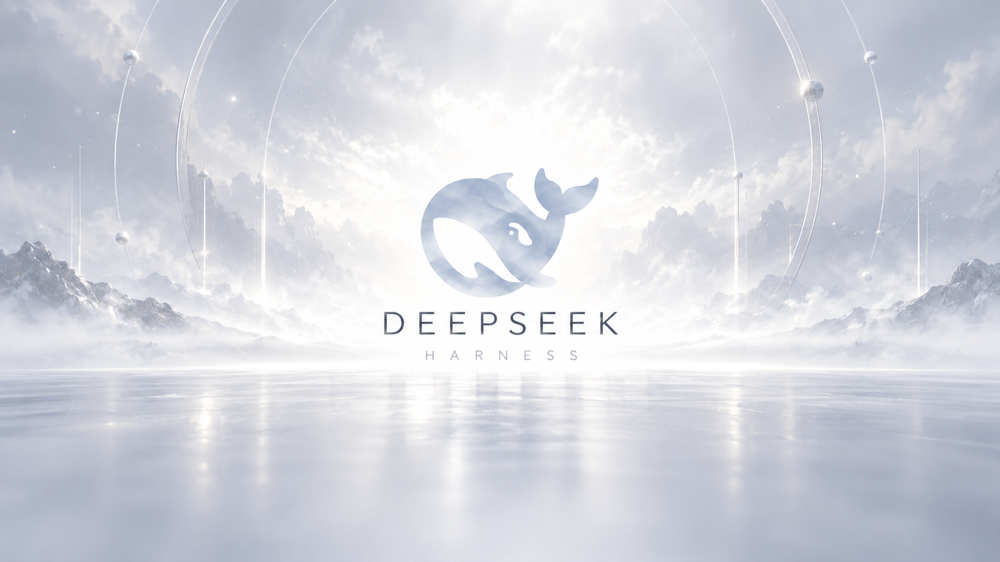

`https://github.com/FerrariLewis/dsh-/releases/download/v1.2.1/dsh-boot-studio-1.2.1.tgz`

在 **DeepSeek Harness → 插件 → 添加插件 → 包名或地址** 中粘贴上方安装码，点击安装并启用。这个安装地址不需要本机 Git，也不需要 npm 账号。

**短安装码：`dsh-openup-lewis`（待 npm 首次发布，暂未生效）。** 短码发布成功后，可在同一个输入框直接使用；仅上传 GitHub 不会注册 npm 包名。当前请使用第一行的 GitHub 安装码。

# DSH Open Beauty · 开场美学

让每一次打开 DeepSeek Harness，都像启动一款喜欢的游戏。

原片完整开场、三款 DeepSeek 标题封面，以及“按任意键进入”的仪式感。你可以使用内置动画，也可以上传自己的视频与图片。



## 安装

在 Harness 的 **插件 → 添加插件** 中粘贴 README 第一行的接入代码，按提示安装并启用。需要时完全退出后重新打开 Harness。

第一行是 **1.2.1 的预构建安装包直链**，由 Harness 直接下载并安装，不需要在终端输入命令，也不调用本机 Git。安装后可以在“设置 → 开机动画 → 版本与更新”继续原位更新。

如果安装时出现 `ERR_PNPM_GIT_RESOLVE_FAILED`，并提示找不到 `git`，请使用第一行的安装包直链。已安装 Git 的电脑也可以使用分支地址 `github:FerrariLewis/dsh-#release-bundles`。

## 像游戏一样开启

**开场动画 → 标题停留页 → 按任意键进入 Harness。**

- 内置与导入视频按原长度、原速自然播放，不截断、不循环补时。
- 技术档案播放完整程序序列，约15秒。设置中不提供时长调整。
- 动画中按一下任意键或点击画面，先到标题页；松开后再按一次才进入。长按不会连跳。
- 标题页停止开场声音，主图保持静止，等候输入。
- 播放层覆盖整个 Harness 窗口，包括侧栏与设置弹窗。

## 自定义你的开场

| 功能 | 内容 |
| --- | --- |
| 五个内置开场 | 品牌序章、霓虹脉冲、数字苏醒、启动问候、技术档案 |
| 自己的视频 | MP4 / M4V / WebM，最大200 MB，推荐H.264 / AAC |
| 三款标题封面 | 白色远山、黑金烟雾、深蓝数字海面，默认白色远山 |
| 自己的结束图片 | PNG / JPEG / WebP，最大20 MB，可切换与移除 |
| 声音和显示 | 静音、音量、铺满窗口或完整显示 |
| 随机与预览 | 每次随机开场，随时预览动画或标题页 |

在 **设置 → 开机动画** 中修改，选择自动保存。浏览器若拦截有声自动播放，动画会静音开始，提供“开启声音”按钮。播放失败时仍能进入可操作的标题页。

这里覆盖的是 Harness 客户端窗口，不会替换系统开机过程或隐藏系统任务栏。关闭到托盘后重新显示同一窗口，不算重新启动。

## 一次安装，持续更新

进入 **设置 → 开机动画 → 版本与更新**，点“检查更新”，有新版本时点“更新到…”。更新包先核对大小、SHA-256、包名与版本，再由 Harness 官方插件管理器原位更新。完成后按提示重新打开 Harness。

**不用先卸载，不用重新导入个人素材。** 视频、结束图片和偏好默认保存在用户目录 `.dsh/boot-studio/`，正常更新不会清除。导入保留原文件，个人媒体不会上传云端。检查更新只连接本项目的 GitHub 发布通道，未发布或网络不可达时本地版本继续使用。

升级会忽略旧版的时长设置，下一次保存时移除该旧字段，其他偏好保留。

## 维护与发布

首次在仓库 **Actions → Publish Open Beauty → Run workflow** 运行发布。绿色完成后，工作流会生成 `release-bundles` 分支、具体版本 Release 和固定维护通道。后续修改代码或素材，同时提高 `package.json.version` 再提交，工作流会自动构建、检查和发布。

内部包ID `dsh-boot-studio` 和用户数据目录保持不变，保证同一插件原位升级。不要用同版本号替换不同的包。

### 启用一词安装码（维护者只需做一次）

`dsh-openup-lewis` 是完整预构建的 npm 分发包，不需要安装者编译。它与 GitHub 分发包使用同一份源码与素材，保留相同的个人设置目录，并通过独立维护清单更新自身。

1. 在 [npm](https://www.npmjs.com/signup) 注册并验证邮箱，按 npm 发布要求完成账号验证。
2. 从本仓库最新版本 Release 下载 `dsh-openup-lewis-版本号.tgz`。在本机运行 `npm login`，再运行 `npm publish 下载文件的完整路径 --access public --ignore-scripts` 完成首次公开发布。
3. 在该 npm 包的 **Settings → Trusted publishing** 添加 GitHub Actions：用户 `FerrariLewis`、仓库 `dsh-`、工作流文件 `publish-npm.yml`，允许直接 `npm publish`。无需提供长期令牌。
4. 确认 npm 已能查询到该包，并在 Harness 实装成功，再将 README 第一行改为 `dsh-openup-lewis`，移除“待首次发布”提示。

后续提高源码版本并提交，GitHub 发布完成后会自动发布对应的 npm 版本。未完成 npm 首发时，该自动流程会明确提示待配置，GitHub 安装方式照常可用。已安装用户在插件设置内检查更新即可；两种分发方式任选一种安装。

Harness“发现”的索引源地址：

```text
https://github.com/FerrariLewis/dsh-/releases/download/channel-stable/plugin-index.json
```

添加后搜索 Open Beauty 或“开机动画”。索引和维护通道在首次发布成功后生效。

## 开发与检查

```sh
pnpm install
pnpm run build
pnpm pack
pnpm test
pnpm exec playwright install chrome
pnpm exec playwright test
```

构建会生成 `lib/` 和独立预览，不需要手工上传生成文件。开发预览可用 `pnpm preview`，打开 `http://127.0.0.1:4179`。独立预览不安装或更新 Harness 插件。

## 来源与许可

四段视频来自 [dsh-boot-animation](https://github.com/NativeDog1/dsh-boot-animation)，按BSD-3-Clause复用。技术档案使用 [dsh-startup-screen](https://github.com/6shenhonghong9/dsh-startup-screen) 的MIT视觉代码与合成音效。三款标题封面由本项目生成并选定。

本项目是社区插件。完整版权与来源见 [第三方说明](THIRD_PARTY_NOTICES.md) 和 [LICENSE](LICENSE)。
