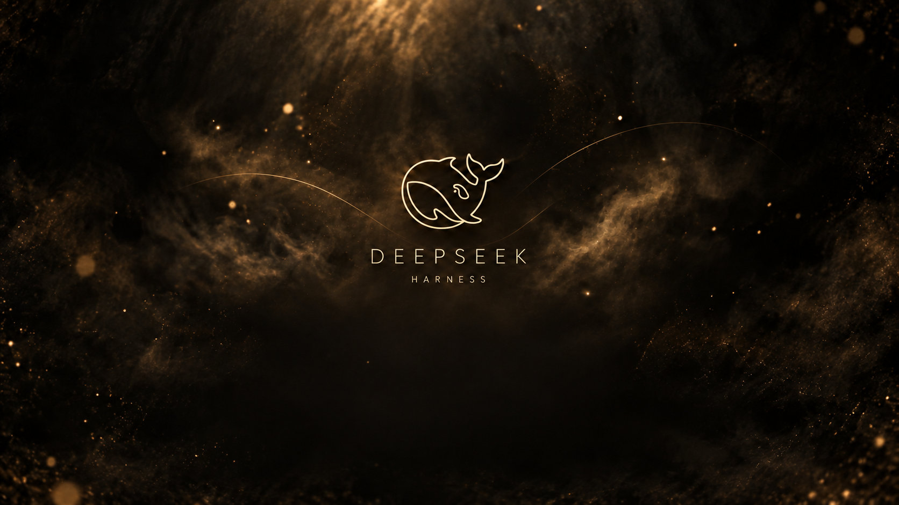
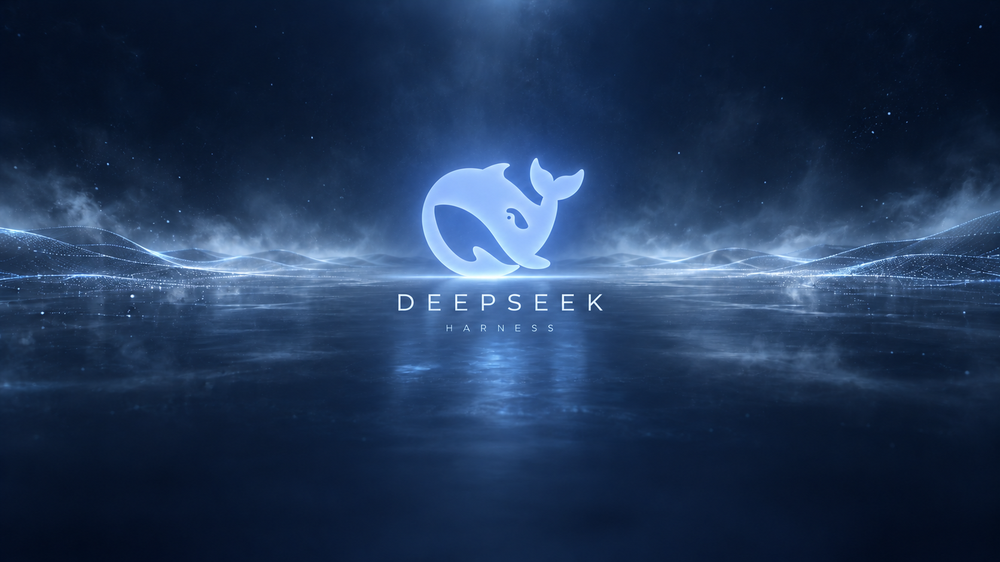

`dsh-openup-lewis`

# DSH Open Beauty · 开场美学

## 产品介绍

为 DeepSeek Harness 带来游戏式的启动体验：全窗口开场动画、DeepSeek 标题封面，以及“按任意键进入”的仪式感。

使用内置开场，或者换上你喜欢的视频和图片，让每次启动都有自己的风格。

## 产品功能

- **完整开场**：内置四段视频和一套“技术档案”动画，视频按原长度、原速播放。
- **任意键进入**：动画中按任意键或点击画面进入标题页，再操作一次进入 Harness；动画自然结束后也会停留在标题页。
- **三款标题封面**：白色远山、黑金烟雾、深蓝数字海面，可随时切换。
- **自定义素材**：上传自己的视频作为开场，上传喜欢的图片作为结束封面。
- **声音与画面**：支持静音、音量调整、铺满窗口或完整显示。
- **随心选择**：固定播放喜欢的动画，或每次随机选择；在设置中直接预览。
- **本地保存**：个人视频、图片和偏好保存在本机，正常更新后保留。

## 产品图片展示

**白色远山**

**黑金烟雾**

**深蓝数字海面**

## 产品基本信息

| 项目 | 信息 |
| --- | --- |
| 产品名称 | DSH Open Beauty · 开场美学 |
| 插件名称 | dsh-openup-lewis |
| 当前版本 | 1.2.4 |
| 作者 | FerrariLewis |
| 适用版本 | DeepSeek Harness ≥ 0.2.1-rc.2 且 < 0.3.0 |
| 安装方法 | 在 Harness → 插件 → 添加插件 → 包名或地址中，粘贴本文第一行的安装码，安装并启用后重新打开 Harness。无需 Git、npm 账号或命令行。 |
| 设置入口 | 设置 → 开机动画 |
| 视频格式 | MP4 / M4V / WebM，单个文件最大 200 MB |
| 图片格式 | PNG / JPEG / WebP，单张图片最大 20 MB |
| 更新入口 | 设置 → 开机动画 → 版本与更新；npm 分发版从 npm 源获取更新。 |
| 开源许可 | [BSD-3-Clause](LICENSE)；素材来源与授权见[第三方说明](THIRD_PARTY_NOTICES.md)。 |
